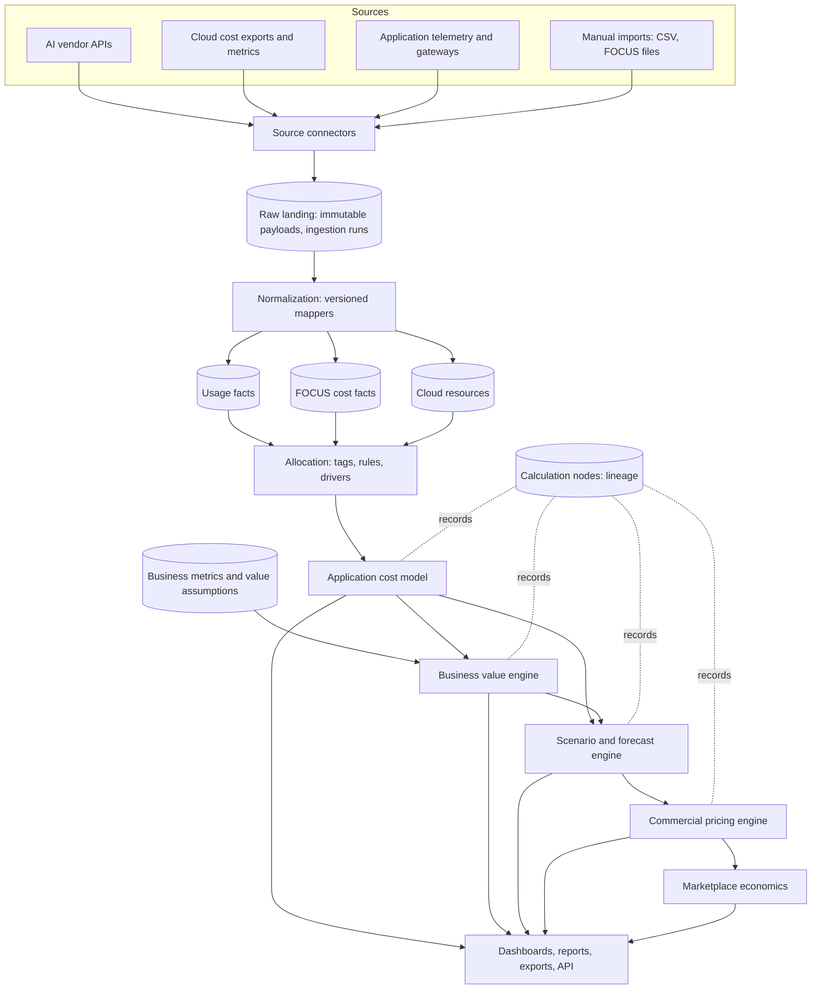
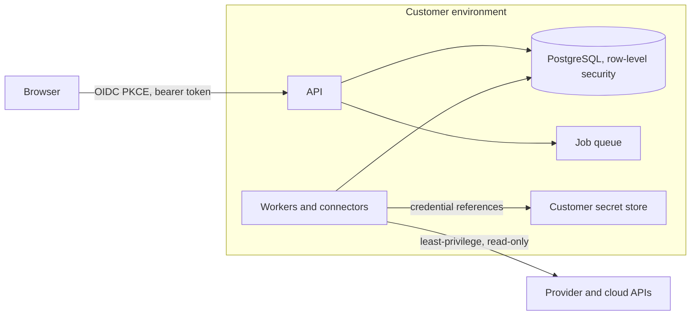

# 2. Target product architecture

**Status:** proposed. Part of the [AI economics redesign](README.md). Builds on the stack decisions in ADR 0004 to 0006, which stay in force.

## Design principles

1. **The application is the unit of analysis.** Tokens, requests and seats are inputs to application economics, not the product.
2. **Raw first, then normalize.** Every connector lands unmodified source data, then a versioned mapper produces normalized facts. Any fact can be rebuilt from raw.
3. **Every number has a basis.** `observed`, `estimated` or `assumed`, set at ingestion or entry and propagated by rules ([calculation engine](05-calculation-engine.md)).
4. **Standards over invention.** Cost is stored in a FOCUS-compatible shape; FinOps Foundation terms name the capabilities ([data model](03-data-model.md)).
5. **Provider behaviour lives in connectors only.** Business logic never branches on a vendor name.
6. **Deterministic, versioned calculation.** The same inputs and formula version give the same output. Money is exact decimal.
7. **Never add overlapping sources.** One source describes a given charge; others are kept for reconciliation, never summed ([overlap resolution](05-calculation-engine.md#10-overlap-resolution)).
8. **Customer-controlled secrets.** Credentials are references into the customer's secret store, used only server-side.

## Pipeline

## Components

| Layer | Responsibility | Notes |
| --- | --- | --- |
| **Source connectors** | Authenticate, discover scope, pull windows, return raw batches plus metadata. Declare capabilities. | Provider-specific code stops here ([connectors](04-connectors.md)). |
| **Raw ingestion** | Store payloads immutably with `ingestion_run`, source, window, hash, received time. Track checkpoints. | Replay and audit anchor. Payloads live in object storage or a `raw` schema; the choice is operational. |
| **Normalization** | Versioned pure mappers: raw to `UsageRecord`, `CostRecord`, `CloudResource`. Currency and unit handling. Sets `basis`. | Re-runnable. A mapper version bump can reprocess history without re-pulling. |
| **FOCUS cost model** | Store cost as FOCUS-compatible `FOCUSCostRecord` plus extension columns for AI and application attributes. | Column set is taken from the current FOCUS specification ([data model](03-data-model.md)). |
| **Allocation** | Assign cost and usage to applications, workloads, customers, business units and environments using tags, explicit rules and usage drivers. Shared and untagged cost goes to a visible *unallocated* bucket. | Implements FinOps allocation, showback and chargeback. |
| **Application cost model** | Total Cost of Application per period from allocated AI, infrastructure, licence, operations and amortized development cost. | Reads facts; writes calculation nodes. |
| **Business value engine** | Value from editable assumptions and observed business metrics. | Assumptions are first-class, versioned records. |
| **Scenario and forecast engine** | Driver-based recalculation of cost, value, ROI, price and margin; sensitivity analysis. | Uses the same calculation library as "Current". |
| **Commercial pricing engine** | Price models, required price for a target margin, break-even, marketplace fees, customer commitment effects. | Fees and rates are configuration. |
| **Experience layer** | Executive dashboard, FinOps workbench, application detail, scenario studio, pricing studio, connector health, explain view. | [UX](06-ux.md). |

## Deployment shape

A **modular monolith first**: one API service, one worker service (connectors, normalization, calculation jobs), one web build served by the API, PostgreSQL, and a customer-managed secret store. This matches `docs/architecture.md` ("separate services are not a requirement") and keeps the customer install small. Module boundaries follow the table above so a module can be split out later.

- **Job runner:** PostgreSQL-backed queue (`SELECT ... FOR UPDATE SKIP LOCKED`) to avoid a new infrastructure dependency. Revisit if throughput demands it.
- **Calculation library:** a pure, versioned Python package with no database access, used by workers and the API. This is what makes results reproducible and testable.
- **Analytics scale:** PostgreSQL with time partitioning handles the first customers. If fact volume outgrows it, add a columnar store fed from the same normalized facts. This is a deferred decision with a stated trigger, not a day-one component.
- **Customer-hosted:** unchanged from ADR 0001. Marketplace is the delivery channel only.

## Security boundaries

| Requirement | Design |
| --- | --- |
| **Tenant isolation** | `tenant_id` on every table; PostgreSQL row-level security keyed to a per-request setting; tests prove cross-tenant reads fail at the database, not only in handlers. A customer-hosted install normally has one tenant; the isolation is still enforced so multi-tenant operation later does not mean a rewrite. |
| **RBAC and SSO** | Existing OIDC and role model kept. Roles extend with finance and executive read roles; scope extends from accounts to tenant, business unit, application and environment. Deny by default. |
| **Secret management** | Connector credentials are references (secret store path or workload identity), resolved by workers at run time. Nothing in the browser, repository, logs, raw payloads or exports. Any value the product must store is envelope-encrypted with a customer-controlled key. |
| **Least privilege** | Each connector publishes the exact read-only permissions it needs; the health check verifies it holds no more than declared where the provider allows inspection. |
| **Audit logging** | Append-only events for sign-in, role and grant changes, connector changes, assumption edits, scenario and price-model changes, exports, and explain-view access. |
| **Connector health** | Per-connector state: credential validity, last success, lag, error class, rows ingested, schema drift. Surfaced in the UI and alertable. |
| **Data retention** | Per-tenant, per-layer retention (raw, normalized, calculation nodes, audit). Deletion is customer-controlled and recorded. |
| **Ingestion traceability** | Each normalized fact points to its raw record and ingestion run. |
| **Client-side secrets** | Forbidden. The browser holds only a short-lived user token; all provider calls are server-side. |

## Provenance architecture

Provenance is a first-class store, not a log. Each headline figure is a **calculation node** recording the formula and its version, the inputs (other nodes, normalized facts or assumptions), the basis of each input, the price book version, and a timestamp. Facts link to raw records by foreign key. The explain view walks **number to calculation to input to source to timestamp** and shows, for any figure, what share of its value is observed, estimated or assumed. Details are in the [data model](03-data-model.md#provenance-entities) and [calculation engine](05-calculation-engine.md#provenance-and-basis-propagation).

## What changes in the current code

The identity, scoping, audit, secret-reference, config, migration and packaging modules carry over. The usage ledger, reconciliation, analytics endpoints, connector protocol and telemetry page are refactored as described in the [gap analysis](01-current-state-and-gap-analysis.md#c-classification-of-existing-capabilities).
