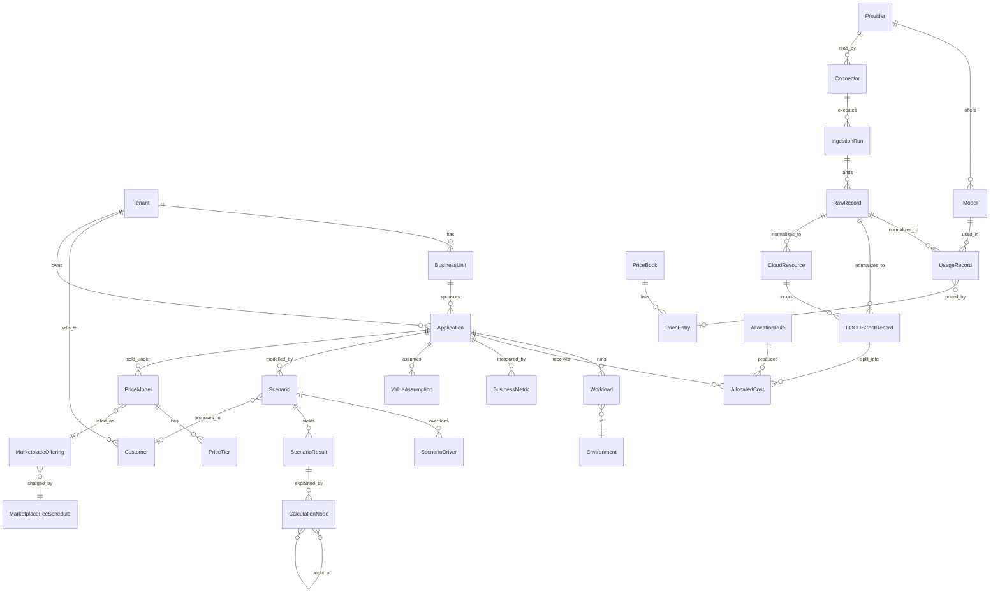

# 3. Canonical data model

**Status:** proposed. Part of the [AI economics redesign](README.md). Column names for the FOCUS entity come from the FOCUS specification and are listed in [FOCUS alignment](#focus-alignment); everything else is this product's own model.

> **Implementation (slice 3).** `FOCUSCostRecord`, connectors, ingestion runs, raw files and rejects exist (migration `0006`) with a CSV importer; see [Manual FOCUS import](04-connectors.md#manual-focus-import-implemented). Costs are stored as `NUMERIC(38,18)`, never rounded. Records are not yet allocated to applications.
>
> **Implementation (slice 2).** The organization, application, price book, assumption, scenario and calculation-node entities below are implemented in migration `0005` with row-level security, composite tenant foreign keys, append-only history and exact numerics. `UsageRecord`, `FOCUSCostRecord`, `AllocatedCost`, `CloudResource`, connectors, ingestion, business metrics, price models and marketplace entities are **not built yet**.

## Conventions

- Every table carries `tenant_id`; row-level security enforces it.
- **`basis`** on every stored or derived figure: `observed` (reported by a source), `estimated` (computed by the product from observed inputs and a stated method), or `assumed` (entered by a user). Never inferred silently.
- **Money** is exact decimal with an ISO 4217 currency; **quantities** are exact decimal with a unit. No floating point for either. Currency conversion uses a stored `FxRate` with source and date.
- Time is UTC with explicit period start and end (half-open).
- Raw records are immutable; normalized facts are rebuildable from raw; calculation nodes are append-only.
- Every normalized fact carries `raw_record_id`, `ingestion_run_id` and `mapper_version`.

## Entity relationships

## Core entities

### Organization and scope

| Entity | Purpose | Key attributes |
| --- | --- | --- |
| `Tenant` | Isolation boundary. | `id`, `name`, `base_currency`, `fiscal_calendar`. One per customer-hosted install in the normal case. |
| `BusinessUnit` | Team or cost owner for showback and chargeback. | `tenant_id`, `name`, `parent_id`, `cost_center`. |
| `Customer` | **A buyer of an application the tenant sells.** Not the tenant. Used for customer-specific pricing and cost per customer. | `tenant_id`, `name`, `segment`, `external_ref`. |
| `Environment` | Prod, test, dev. | `name`, `kind`. |

### Application model

| Entity | Purpose | Key attributes |
| --- | --- | --- |
| `Application` | The AI solution; the primary unit of analysis. | `name`, `business_unit_id`, `owner`, `lifecycle` (build, run, retire), `initial_investment` (money, basis), `amortization_months`, `description`. |
| `Workload` | A runnable part of an application in an environment. | `application_id`, `environment_id`, `name`, `kind` (inference, retrieval, batch, agent, UI). |
| `ApplicationCustomer` | Which customers an application serves, and the share of usage. | `application_id`, `customer_id`, `usage_share`, `basis`. |

### Sources and ingestion

| Entity | Purpose | Key attributes |
| --- | --- | --- |
| `Provider` | A source system: AI vendor, cloud, SaaS, gateway, internal app, manual import. | `key`, `kind`, `display_name`. |
| `Connector` | A configured instance bound to a tenant. | `provider_id`, `credential_ref` (secret-store reference only), `scope`, `schedule`, `enabled`. |
| `ConnectorHealth` | Latest state. | `connector_id`, `credential_status`, `last_success_at`, `lag`, `last_error_class`, `schema_drift`. |
| `IngestionRun` | One pull. | `connector_id`, `window_start`, `window_end`, `started_at`, `finished_at`, `status`, `row_count`, `cursor`. |
| `RawRecord` | Immutable source payload or file reference. | `ingestion_run_id`, `payload_ref`, `content_hash`, `received_at`, `schema_version`. |

### Normalized facts

| Entity | Purpose | Key attributes |
| --- | --- | --- |
| `Model` | A model or service SKU as the source names it. | `provider_id`, `model_key`, `family`, `modality`. |
| `UsageRecord` | One normalized measurement of consumption. **Not limited to tokens.** | `measure` (see below), `quantity`, `unit`, `period_start`, `period_end`, `grain` (request, session, hour, day), `finality`, `provider_id`, `model_id`, `application_id` (nullable until allocated), `resource_id`, `user_ref` (only if the source supplies authenticated correlation), `basis`, lineage columns. |
| `CloudResource` | A cloud or infrastructure resource. | `provider_id`, `resource_id`, `resource_type`, `region`, `account_ref`, `tags` (jsonb), `first_seen`, `last_seen`. |
| `FOCUSCostRecord` | One normalized cost line in FOCUS 1.4 shape. | FOCUS columns plus `x_` extensions ([below](#focus-alignment)); `basis`, `finality`, lineage columns. |
| `BusinessMetric` | An **observed** business measure for an application (transactions, active users, outcomes). | `application_id`, `metric_key`, `period`, `value`, `unit`, `source`, `basis`. |

**`UsageRecord.measure`** is an enumerated type with a unit: `input_tokens`, `output_tokens`, `cached_input_tokens`, `cache_write_tokens`, `reasoning_tokens`, `requests`, `sessions`, `active_users`, `seats_assigned`, `seats_active`, `compute_hours`, `storage_gb_month`, `network_gb`, `api_calls`. A source that exposes only seats produces only seat measures; the model never invents tokens.

### Pricing and allocation

| Entity | Purpose | Key attributes |
| --- | --- | --- |
| `PriceBook` / `PriceEntry` | Versioned unit prices used to *estimate* cost when observed cost is absent. | `provider_id`, `model_id`, `measure`, `unit_price`, `currency`, `effective_from/to`, `source` (list, negotiated, observed-derived), `basis`. |
| `AllocationRule` | How cost and usage reach an application. | `method` (tag, direct, proportional-by-driver, fixed-percent, even), `match`, `driver`, `priority`, `version`. |
| `AllocatedCost` | A slice of a `FOCUSCostRecord` assigned to an application. | `focus_cost_id`, `application_id`, `workload_id`, `share`, `amount`, `rule_id`, `basis`. Unmatched cost is allocated to an explicit *unallocated* bucket, never dropped. |

### Value, scenarios and commercial

| Entity | Purpose | Key attributes |
| --- | --- | --- |
| `ValueAssumption` | An editable, versioned input to business value. | `application_id`, `key` (baseline_hours, assisted_hours, loaded_rate, realization_factor, errors_avoided, cost_per_error, revenue_uplift, margin_on_revenue, avoided_cost, ...), `value`, `unit`, `basis` (usually `assumed`), `rationale`, `author`, `version`. |
| `Scenario` | A named model run. | `application_id`, `kind` (baseline, current, forecast, optimized, customer_proposal), `base_scenario_id`, `customer_id`, `status`. |
| `ScenarioDriver` | An override. | `scenario_id`, `driver_key` (users, adoption, interactions_per_user, tokens_per_interaction, model_mix, cloud_rate, commitment_level, labor_rate, price), `value`, `basis`. |
| `ScenarioResult` | Outputs for a scenario and period. | `ai_cost`, `infra_cost`, `total_cost`, `unit_costs`, `business_value`, `net_value`, `roi`, `payback_months`, `required_price`, `gross_margin`, `calculation_root_id`. |
| `PriceModel` / `PriceTier` | A way of selling. | `application_id`, `kind` (subscription, per_user, usage, per_transaction, per_token, application, tiered, customer_specific), `currency`, tier boundaries and unit prices. |
| `MarketplaceOffering` | A listing on a marketplace. | `marketplace` (aws, azure, other), `offer_type` (public, private), `fee_schedule_id`, `commitment_drawdown_eligibility`. |
| `MarketplaceFeeSchedule` | **Configurable** fee rules. | `kind` (percent, fixed, tiered), `rate`/tiers, `effective_from/to`, `source_note`. Never hard-coded. |

### Provenance entities

| Entity | Purpose | Key attributes |
| --- | --- | --- |
| `CalculationNode` | One computed figure and how it was produced. | `value`, `unit`, `currency`, `formula_id`, `formula_version`, `inputs` (references to nodes, facts or assumptions), `basis_mix` (share observed, estimated, assumed), `price_book_version`, `computed_at`. |
| `AuditEvent` | Append-only security and change log (exists today). | `actor`, `action`, `target`, `detail`, `at`. |
| `RetentionPolicy` | Per-layer retention. | `layer`, `retain_for`, `legal_hold`. |

## FOCUS alignment

**Sources for this section:** the FOCUS specification and column pages at <https://focus.finops.org/> and the FinOps Foundation pages on FinOps for AI, read on 2026-11-07. Items below marked **[VERIFY]** were not confirmed from the pages read and must be checked against the specification before the schema is frozen.

### Version

- The current published version is **FOCUS 1.4**. **FOCUS 1.5** is in review, with ratification scheduled for December 2026; it is additive ("data that conforms to FOCUS 1.4 stays valid as 1.4"). Earlier versions 1.0 to 1.3 exist.
- Sources will not all emit the same version. Azure Cost Management's FOCUS export is documented as 1.2-preview, and AWS Data Exports lists FOCUS 1.0 and 1.2 "with AWS columns". The cost layer therefore **targets 1.4 and upgrades older inputs on ingestion**, recording the source version in `x_source_focus_version`.

### Columns used

`FOCUSCostRecord` stores the Cost and Usage dataset. FOCUS 1.4 lists 65 columns there; identifiers are written without spaces (`BilledCost`, `ConsumedQuantity`, `ResourceId`). Groups, by name:

| Group | Columns |
| --- | --- |
| Cost | `BilledCost`, `EffectiveCost`, `ListCost`, `ListUnitPrice`, `ContractedCost`, `ContractedUnitPrice`, `BillingCurrency`, `PricingCurrency` (and pricing-currency variants of effective cost and unit prices) |
| Quantity and unit | `ConsumedQuantity`, `ConsumedUnit`, `PricingQuantity`, `PricingUnit` |
| Charge | `ChargeCategory`, `ChargeClass`, `ChargeDescription`, `ChargeFrequency`, `ChargePeriodStart`, `ChargePeriodEnd`, `PricingCategory` |
| Commitment | `CommitmentDiscountCategory`, `...Id`, `...Name`, `...Quantity`, `...Status`, `...Type`, `...Unit`, `CommitmentProgramEligibilityDetails`, `ContractApplied` |
| Allocation | `AllocatedMethodId`, `AllocatedMethodDetails`, `AllocatedResourceId`, `AllocatedResourceName`, `AllocatedTags` |
| Account and period | `BillingAccountId/Name/Type`, `SubAccountId/Name/Type`, `BillingPeriodStart/End` |
| Resource and service | `ResourceId`, `ResourceName`, `ResourceType`, `Tags`, `ServiceName`, `ServiceCategory`, `ServiceSubcategory`, `ServiceProviderName`, `HostProviderName`, `InvoiceIssuerName` |
| SKU and location | `SkuId`, `SkuMeter`, `SkuPriceDetails`, `SkuPriceId`, `RegionId`, `RegionName`, `AvailabilityZone`, capacity reservation columns |
| Invoice | `InvoiceId`, `InvoiceDetailId` |

Only `BilledCost`, `EffectiveCost`, `ListCost`, `ContractedCost` and `ChargeCategory` were confirmed **mandatory**; requirement levels for the rest are **[VERIFY]**. `ChargeCategory` allows `Usage`, `Purchase`, `Tax`, `Credit`, `Adjustment`.

### Cost definitions the engine relies on

- **Billed Cost:** cost as invoiced by the invoice issuer in a billing period.
- **Effective Cost:** cost based on resources and services used or contract commitments; for usage it includes the amortized portion of purchases such as prepayments. A commitment *purchase* has `EffectiveCost` 0 when it covers eligible usage. This is the default measure for application cost (no double counting of commitment purchases).
- **List Cost / Contracted Cost:** list and negotiated price times `PricingQuantity`; the gap between them and `EffectiveCost` is the measurable saving.
- Prepaid purchases are identified by `ChargeCategory = Purchase` with `BilledCost > 0` and `EffectiveCost = 0`.

### AI and non-cloud charges

- **FOCUS 1.4 has no AI-specific columns.** Token charges appear as a `SkuId` with `ConsumedUnit` and `ConsumedQuantity` recording tokens.
- The **FOCUS 1.5 working draft** recommends, without new columns: `ConsumedUnit` names `Token`, `Request`, `Character`, `Image`, `Job`, `Message`, `Page`, `Session`; and `SkuPriceDetails` properties `ModelDeveloper`, `ModelFamily`, `ModelId`, `ModelVersion`, `TokenDirection` (`Input` or `Output`) and `TokenCacheAction` (`Uncached`, `Read`, `Write`, `Other`). It also adds `PrincipalId`, `CredentialId` and `RequesterDetails` (conditional) for the identity behind a charge. This is a **draft**: adopt it as the product's convention now and confirm it at ratification.
- Non-cloud providers use `ServiceProviderName`, `HostProviderName` and `InvoiceIssuerName`; their exact definitions are **[VERIFY]**. `InvoiceIssuerName` is the natural key for the *billing owner* used in [overlap resolution](05-calculation-engine.md#10-overlap-resolution).
- Seats and licences have no recommended unit name in the draft list; they use a product-defined `ConsumedUnit` (`Seat`) **[VERIFY]**.

### Mapping from usage measures

| `UsageRecord.measure` | `ConsumedUnit` | `TokenDirection` | `TokenCacheAction` |
| --- | --- | --- | --- |
| `input_tokens` | Token | Input | Uncached |
| `cached_input_tokens` | Token | Input | Read |
| `cache_write_tokens` | Token | Input | Write |
| `output_tokens` | Token | Output | n/a |
| `reasoning_tokens` | Token | provider-defined **[VERIFY]** | n/a |
| `requests` | Request | n/a | n/a |
| `sessions` | Session | n/a | n/a |
| `seats_assigned`, `seats_active` | Seat (product-defined) | n/a | n/a |

### Extension columns

Product-specific and prefixed `x_` so they cannot collide with FOCUS: `x_basis` (observed, estimated, assumed), `x_finality` (`provisional` or `final`; see below), `x_source_focus_version`, `x_raw_record_id`, `x_ingestion_run_id`, `x_mapper_version`, `x_application_hint`.

### Provisional versus final

Sources revise data after first publishing it: Azure charges can change until the fifth day after a billing period ends, and Anthropic reports values can be revised until about seven days after month end. Every cost and usage fact therefore carries **`finality`**. `provisional` figures are shown, and forecasts and "actuals" labels respect it; `final` is set when the source's revision window has closed. Revisions replace by natural key with a revision counter, as the ledger already does for aggregates.

## How the existing tables map

| Existing table | Becomes |
| --- | --- |
| `usage_request_observations` | `UsageRecord` rows with `grain = request`, `basis = observed`, `provider = app gateway`. |
| `usage_aggregate_observations` | `UsageRecord` rows with `grain = hour/day`; the connector's `RawRecord` is now retained. |
| `collection_checkpoints` | `IngestionRun.cursor` / connector state. |
| `role_assignments`, `account_grants`, `audit_events` | Kept; grants re-scoped to business unit, application, environment. |
| `Float value` | `NUMERIC` quantity and cost columns. |

Migration is additive first: new tables and a backfill that writes normalized facts from the existing ledger, with the old tables retained until the new read paths are proven.
